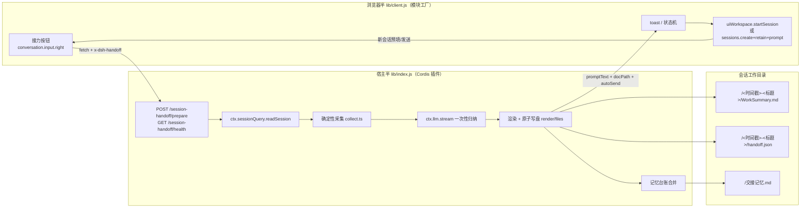
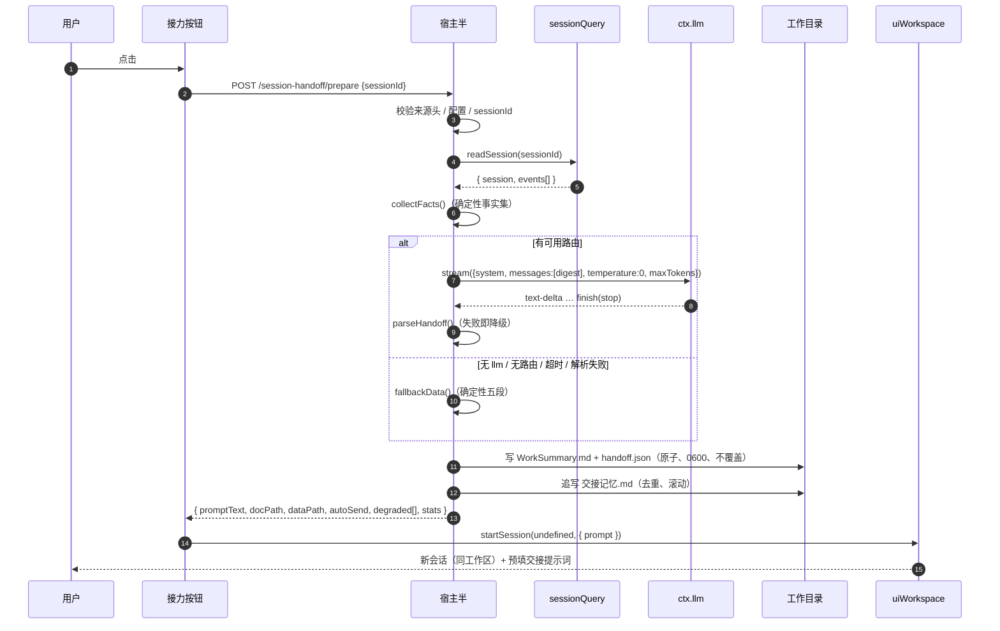

# 技术设计：dsh-session-handoff

> 版本：0.1.0（MVP）｜基线：DSH `0.2.1-rc.2`、node ≥ 22.19、零运行时依赖
> 关联文档：[01 插件机制](./01-DSH插件机制分析.md) · [02 调研](./02-同类插件调研.md) · [04 可行性](./04-可行性分析.md) · [05 产品设计](./05-产品设计.md)

---

## 1. 目标与非目标

### 目标

1. 在 DSH 会话页**提交按钮旁**提供一个常驻动作：「接力到新会话」。
2. 一次点击完成：读取当前会话 → 提炼工作内容 → 优化/固化记忆 → 生成工作总结文档 → 打开新会话并带上内容与参考文档。
3. **不中断、不修改**当前会话；失败时可降级、可重试、可复制。
4. 产物是**可读、可归档、可进 Git** 的 Markdown，而不是只存在于内存里的摘要。
5. 插件可独立安装/卸载，不依赖任何第三方运行时包。

### 非目标（v0.1 明确不做）

- 不替代 DSH 的压缩（compaction）机制，不接管任何宿主后端。
- 不做跨机器/跨用户同步；不自动提交 Git；不自动删除旧会话。
- 不实现通用长期记忆库（记忆候选只落本地台账，v0.2 再做适配器）。
- 不支持子会话/只读会话的批量交接（v0.3 考虑多会话聚合）。
- 不引入新的网络出口：不调用 DSH 模型路由之外的任何服务。

---

## 2. 总体架构



设计原则（与 [01](./01-DSH插件机制分析.md) 的稳定性分级一致）：

| 原则 | 落地 |
|---|---|
| A 级接缝做主线 | slot 座位、`sessionQuery.readSession`、`llm.stream`、`webServer.register`、`uiWorkspace.startSession` |
| B 级只做可选增强 | `sessions.create/retain/prompt`（仅 `autoSend`） |
| C 级永不触碰 | 不查/不改 DOM class、不接管宿主后端、不改会话日志 |
| 每个增强都有降级 | 见 §11 降级矩阵 |
| 产物优先 | 文档先落盘，提示词只是文档的「指针 + 摘要」 |

---

## 3. UI 座位与交互

### 3.1 座位选择

| 候选 | 结论 | 理由 |
|---|---|---|
| `conversation.input.right` | **采用** | list/session，官方语义「提交动作之前的紧凑控件」，当前 `occupants: []`；渲染点 `InputBar.tsx:475` |
| `conversation.input.activity` | 不用 | single，注册即遮蔽语音输入；owner props 要求实现展开/收起 |
| `conversation.session.header.utilities` | 降级 | 标题栏右侧；语义是「会话实用工具」，视觉不在提交键旁 |
| `conversation.composer.dock` | 不用 | 环境条（活动/用量 pill），位置偏离动作区 |
| DOM 克隆 / MutationObserver | **禁止** | C 级私有耦合，升级即断 |

`InputBar` 的实际渲染顺序（`packages/client/ui-conversation/src/client/skeleton/InputBar.tsx:449-476`）：

```text
[+ 附件] [权限] [计划] [input.left] …… [input.right] [model] [activity] [停止/发送]
```

> 说明：DSH 把模型选择器放在 `input.right` 与发送键之间，因此按钮的视觉位置是「发送按钮所在的右侧工具行、
> 模型选择器左侧」，不是像素级紧贴发送键。这是在不遮蔽原生控件、不碰私有 DOM 的前提下，官方座位能给到的最近位置。
> v0.2 会评估是否提供 `conversation.input.activity` 的「接管模式」（用户显式开启才遮蔽语音输入）。

### 3.2 组件状态机

```text
idle ──click──▶ busy ──ok──▶ done(1.2s) ──▶ idle
                  │
                  ├─error──▶ error(1.2s) ──▶ idle   + toast(错误原因)
                  └─disabled（无 sessionId 时不渲染点击逻辑）
```

- 按钮 28×28，图标为「方框 + 出栈箭头」，`title`/`aria-label` 走本地化文案；
- `busy` 时显示转圈、`aria-busy=true`、`disabled`；
- 成功 toast：`已生成交接文档，新会话已预填提示词：<标题>`（autoSend 时文案为「已发送」）；
- 失败 toast：`会话接力失败：<原因>`，原因包含 HTTP 状态或宿主返回码；
- 失败不会破坏草稿：如果新会话已打开但注入失败，提示词仍在剪贴板（见 §9.3）。

### 3.3 本地化

- 有 `ctx.locale` 时注册命名空间 `handoff`（zh/en 词典），由 `t()` 提供文案；
- 无 locale 时按 `navigator.language` 回退内置词典；
- 词典同时用于 tooltip、aria-label、toast。

### 3.4 样式

- 一次性 `<style>` 注入（`id=dsh-session-handoff-style`），幂等；
- 全部颜色/圆角/字体走 `--dsw-alias-*`、`--dsw-radius-*`、`--dsw-font-family`，跟随明暗主题；
- hover/focus-visible/busy/done/error 五态；不改动任何宿主样式。

---

## 4. 数据流时序



耗时预期：读取 + 采集（毫秒级）→ 模型归纳（通常 5–30s）→ 写盘（毫秒级）。
按钮的 `busy` 态覆盖全流程；宿主端有 `timeoutMs`（默认 180s）兜底。

---

## 5. 会话读取策略

| 场景 | 路径 | 结果 |
|---|---|---|
| 正常（DSH 0.2.x） | `ctx.sessionQuery.readSession(id)` | 完整原始日志（live 优先、回放校验），含 `tool/call`、`request/header`、压缩摘要 |
| 缺少 sessionQuery，会话在内存 | `ctx.sessions.get(id).deriveMessages()` | 只有 surface 消息，无工具参数；降级标记 `no-session-query` |
| 会话不存在/已删除 | `readSession` 抛错 / `get` 返回 undefined | HTTP 404 `session-not-found` |
| 会话正在运行 | 同上（读取是旁路快照） | 允许；交接基于当前已提交日志 |

**为什么不订阅 `session/event` 做实时采集**：交接是一次性动作，需要「到此为止」的稳定快照；
`readSession` 的原子观测语义正好匹配。实时订阅只适合常驻面板。

**为什么不写会话日志**：写事件会进入模型上下文（surface）或改变压缩/回放语义；交接属于旁路产物。
社区同类方案（`dsh-context-zip`）也明确「不往会话日志写事件」。

---

## 6. 确定性采集（collect.ts）

输入 `events[]`，输出 `Facts`。所有规则都是「只读、可解释、可单测」：

| 事件 | 提取 | 用途 |
|---|---|---|
| `user/message`（`source.kind === 'user'`） | 文本，按时间 | 目标与意图、诉求演变 |
| `user/message`（其它来源） | 文本，最多 8 条、每条 600 字 | 注入上下文（区分「用户说的」与「系统注入的」） |
| `assistant/message` | `data.message.content` 文本块，保留最近 120 条 | 已完成/当前状态 |
| `tool/call` | 名称 + 原始 arguments（截 600 字） | 工具活动时间线、文件/命令提取 |
| `tool/result` | `message.isError`、内容摘要（截 600 字） | 失败与阻塞 |
| `compaction/summary` | 摘要文本（截 3000 字，最多 3 条） | 被压缩掉的历史 |
| `request/header` | `data.header.config.{provider,model}` | 摘要路由回退 |

**文件与命令提取规则**（`pathsFromArguments`）：

1. 补丁式参数里的 `*** Update File: <path>` / `*** Add File:` / `*** Delete File:` 行；
2. JSON 参数递归（深度 ≤ 4）匹配键名正则：文件 `path|file|filepath|file_path|notebook_path|target|filename`；
   命令 `command|cmd|script|shell`；
3. 非 JSON 参数：工具名匹配 `bash|shell|terminal|exec|run` 时整段视为命令；
4. 去重、限量（文件 200、命令 120），保持首次出现顺序。

**预算**：工具调用最多 400 条（保留最近的）、用户消息 80 条、助手进展 120 条；防止畸形/超长日志吃内存。
`maxToolCalls` 可配置。

**降级标记**：`empty-log`、`no-work-signal`、`no-title`、`no-cwd`、`no-session-query`。

---

## 7. 模型归纳（summary.ts）

### 7.1 调用形态

```ts
ctx.llm.stream({
  provider, model,                    // 显式配置 > 会话最后一次 request/header
  system: SYSTEM_PROMPT,              // 固定协议
  messages: [{ role: 'user', content: [{ type: 'text', text: digest }] }],
  temperature: 0,
  maxTokens: config.maxTokens,        // 默认 4096
  signal,                             // AbortController + timeoutMs
})
```

- 流分片只消费 `text-delta` / `block-end(text)` / `finish`；
- `finish.reason.kind !== 'stop'` 视为失败（`error` / `aborted` / `max-tokens` 等）；
- **不写会话日志、不写请求头、不声明 purpose**：这是一次旁路辅助调用，产物即交接文档；
- 路由解析顺序：`config.provider/model` → 会话 `request/header` → 无 → 直接降级（不猜路由）。

### 7.2 输出协议

固定 JSON（无 Markdown 围栏），字段与上限：

```json
{
  "title": "≤24 字",
  "summary": "≤120 字",
  "goal": "≤300 字",
  "completed": ["≤80 字，带可验证结果"],
  "decisions": [{ "decision": "…", "rationale": "…" }],
  "state": { "current": "…", "files": ["…"], "blockers": ["…"] },
  "nextSteps": [{ "step": "…", "why": "…" }],
  "memoryCandidates": [{ "text": "…", "scope": "memory|user|project" }]
}
```

解析器 `parseHandoff()` 的宽松策略：剥离代码围栏 → 取第一个 `{` 到最后一个 `}` → `JSON.parse` →
逐字段裁剪/类型纠正 → 非法即返回 `undefined` 触发降级。**模型输出永不直接导致失败**。

### 7.3 输入预算

`buildDigest()` 把事实集渲染成 Markdown（元数据 / 用户诉求 / 助手进展 / 压缩摘要 / 工具活动 / 失败 / 文件 / 命令），
超过 `maxInputChars`（默认 80,000 字符）时**保头 60% + 保尾 40%**，中间标注省略字数。
中文场景下 80k 字符约 4–8 万 token，需按模型上下文与成本下调。

### 7.4 确定性兜底

`fallbackData()` 不调用模型：

- 标题：会话标题 → 第一条用户消息首句 → `会话交接`；
- 目标：第一条用户诉求（无则最后一条）；
- 已完成：改/读过的文件 + 最近 3 条助手正文首行；
- 当前状态：最后一条助手正文（截 500 字）+ 失败列表；
- 下一步：固定一条「先读交接文档确认现状」；
- 记忆候选：空（不编造）。

文档 front matter 标注 `generated_by: dsh-session-handoff/deterministic`，`degraded` 记录原因。

---

## 8. 文档与落盘（render.ts / files.ts）

### 8.1 目录布局

```text
<cwd>/
└── <config.dir 默认 .dsh-handoff>/
    ├── <YYYYMMDD-HHmmss>-<标题 slug>/
    │   ├── WorkSummary.md
    │   └── handoff.json
    └── 交接记忆.md
```

- 目录名为「时间戳 + 标题（保留中英文字符，截 40 字）」；
- 同名冲突时追加 `-2`、`-3`…（非递归 `mkdir` 的原子性保证独占），**绝不覆盖**；
- `slug` 清洗 `[^\p{L}\p{N}-]`，避免路径注入与跨平台非法字符。

### 8.2 WorkSummary.md 结构

```markdown
---
session / title / cwd / session_created / handoff_created / model / generated_by / events / tool_calls / degraded?
---
# 会话交接：<title>
> 一句话摘要
## 目标与意图
## 已完成
## 关键决策（表格：决策 | 依据）
## 当前状态（+ 相关文件 + 阻塞与风险）
## 下一步（编号：动作 —— 理由）
## 记忆候选（[scope] 文本）
## 参考文件
## 附录：工具活动（最近 60 条表格）
```

`handoff.json`（`schema: dsh-session-handoff/v1`）包含同样的 handoff 数据 + 源会话元数据 + 文件/命令清单，
供下游工具或后续自动化消费。

### 8.3 写入安全

- 所有目标路径经 `resolveInside(cwd, dir)`：拒绝绝对路径、`..`、越界；
- `cwd` 必须是绝对路径（`SessionHeader.cwd` 语义），否则返回 409 `no-cwd`；
- 原子写：同目录临时文件（`0600`）→ `rename`；失败不留半截文件；
- 记忆台账超过 256KB 时先滚动为 `.1` 再写新内容（不静默丢历史）。

---

## 9. 记忆固化

### 9.1 v0.1：最小可读台账

`<dir>/交接记忆.md`：

```markdown
# 交接记忆
> 由 dsh-session-handoff 维护：跨会话仍然成立的项目约定、用户偏好与环境事实。
## 2026-10-23 03:15 · 建立会话接力插件
来源：交接文档（session `session-…`）
- `memory` 第三方插件不 import @deepseek-ai 运行时模块
- `project` 交接文档统一写入 .dsh-handoff/
```

规则：

- 只写 `memoryCandidates`，来源可追溯（时间、标题、源会话）；
- **去重**：台账中已包含该条文本则跳过；
- 用户可随时删改；下次交接不会重新写回被删的条目（除非模型再次产出）；
- 默认开启，可 `writeMemory: false` 关闭。

### 9.2 与记忆插件的关系

`dsh-mnemon` 等记忆插件有自己的写入协议（项目档案、记忆空间、运行时 USER/MEMORY）。
v0.1 不直接写它们的库：**跨插件的私有存储不是稳定契约**。v0.2 计划做适配器：

- 探测已装记忆插件的公开能力（工具/服务），把 `memoryCandidates` 作为「候选」提交，由对方去重/归档；
- 无适配器时退回本地台账。

### 9.3 为什么默认不直接改 MEMORY.md

- 运行时记忆（`USER.md` / `MEMORY.md`）是每轮注入的预算敏感资源，自动追加会挤占上下文；
- 记忆写入应有「用户可见/可撤销」的确认；v0.1 用独立台账 + 文档里的「记忆候选」保留可控性；
- 产品设计（[05](./05-产品设计.md)）把「晋升到运行时记忆」列为 v0.2 的显式动作。

---

## 10. 新会话注入

| 模式 | 实现 | 优点 | 风险 |
|---|---|---|---|
| **draft（默认）** | `uiWorkspace.startSession(undefined, { prompt })` | 官方导航服务；同工作区分组；发送前可改；零半公开依赖 | 需要用户再按一次发送 |
| **autoSend（可选）** | `sessions.create({}) → retain → prompt(…, 'queue') → uiWorkspace.openSession(id)` | 真正「一键继续」 | 依赖 B 级服务；失败需要回退 |
| **fork 历史** | `ctx.sessions.fork(source, boundary)` | 完整继承上下文 | 上下文成本照旧，等于没解决「上下文满」；且不是「总结」诉求 |

`startSession(workspaceId?, options)` 的 `DraftInitializationOptions` 只有 `prompt` 与 `clearPreviousDraft`
（`packages/client/ui-conversation/src/client/contract/input.ts:233-236`）：
`prompt` 会作为**草稿文本**初始化编辑器，不是自动发送。这正好是我们要的确认点。

**参考文档如何带入**：

1. 文档路径以**绝对路径**写进 prompt（新会话 `cwd` 相同，Read 工具可直接打开）；
2. 参考文件清单来自采集器（工具调用里识别出的文件），按「改了/读了」优先排序，最多 12 条；
3. v0.2 计划接入 `@` 引用 chip（`dsh-reference-anything` 一类能力），让文件以引用而不是纯文本进入输入框。

**autoSend 的失败回退**：`sessions.create/retain/prompt` 任一步失败 → toast 提示 → 改走 `startSession` 草稿；
两者都不可用 → 抛错，toast 提示并把提示词复制到剪贴板（避免用户丢失摘要）。

---

## 11. HTTP 契约

### 11.1 `GET /session-handoff/health`

```json
{
  "ok": true,
  "plugin": "dsh-session-handoff",
  "version": "0.1.0",
  "enabled": true,
  "capabilities": { "sessionQuery": true, "sessions": true, "llm": true },
  "config": { "dir": ".dsh-handoff", "writeMemory": true, "autoSend": false, "route": "session" },
  "warnings": []
}
```

用途：浏览器半/排障确认宿主半是否加载、能力是否齐全（相当于 Bridge 的 `--doctor` 的最小版）。

### 11.2 `POST /session-handoff/prepare`

请求头：`content-type: application/json`、`x-dsh-handoff: 1`（必需）、同源 `Origin`。

```json
{ "sessionId": "session-xxxxxxxx" }
```

成功响应（200）：

```json
{
  "ok": true,
  "sessionId": "session-xxxxxxxx",
  "title": "建立会话接力插件",
  "promptText": "# 会话接力：…（新会话提示词）",
  "markdown": "# 会话交接：…（完整文档）",
  "data": { "title": "…", "summary": "…", "completed": [], "nextSteps": [] },
  "docPath": "/abs/path/.dsh-handoff/20261023-031500-…/WorkSummary.md",
  "dataPath": "/abs/path/.dsh-handoff/20261023-031500-…/handoff.json",
  "memoryPath": "/abs/path/.dsh-handoff/交接记忆.md",
  "memoryCandidates": [{ "text": "…", "scope": "memory" }],
  "autoSend": false,
  "degraded": ["llm-failed:…"],
  "stats": { "events": 128, "toolCalls": 42, "files": 11, "chars": 9210, "llm": true, "model": "deepseek/deepseek-chat", "durationMs": 8421 }
}
```

失败响应：`{ ok: false, code, message }`。

| HTTP | code | 触发 |
|---|---|---|
| 400 | `bad-request` / `bad-json` / `bad-session` | 空 body、非法 JSON、sessionId 格式不符 |
| 403 | `forbidden` | 缺 `x-dsh-handoff: 1`，或 Origin 与 Host 不一致 |
| 404 | `session-not-found` | 会话不存在/已删除 |
| 405 | `method-not-allowed` | 方法不对 |
| 409 | `no-cwd` | 会话没有绝对 `cwd` |
| 413 | `body-too-large` | 超过 `maxBodyBytes`（默认 256KB） |
| 500 | `internal` | 读取失败、写盘失败等未预期错误 |
| 503 | `disabled` | 配置 `enabled: false` |

### 11.3 安全设计

- **同源**：自定义头 + Origin/Host 比对，挡跨站表单与简单请求；
- **不提供 CORS**：不做跨域白名单，避免被任意网页调用；
- **无鉴权 token**：端点在 loocalhost 同源下由 DSH 会话页面调用；远程访问 DSH 时，DSH 自身的外层鉴权仍然生效；
- **输入限制**：body ≤ 256KB、sessionId 正则 `^[A-Za-z0-9][A-Za-z0-9._:-]{0,127}$`；
- **输出限制**：`markdown` 会随响应返回（便于预览），长度为文档实际大小（几十 KB 量级）。

---

## 12. 配置

```yaml
- insert:
    - id: session-handoff
      name: dsh-session-handoff
      config:
        enabled: true
        dir: .dsh-handoff          # 相对 cwd；拒绝绝对路径与 ..
        memoryFile: 交接记忆.md
        writeMemory: true
        provider: ''               # 两者都给才生效
        model: ''
        maxTokens: 4096
        maxInputChars: 80000
        maxToolCalls: 400
        promptCharBudget: 6000
        autoSend: false
        timeoutMs: 180000
        maxBodyBytes: 262144
```

全部字段可选；校验失败/越界会夹取到合法范围并在日志与 `health.warnings` 里告警，**不会导致插件加载失败**。

---

## 13. 降级矩阵

| 缺失/失败 | 行为 | 用户可见结果 |
|---|---|---|
| `ctx.sessionQuery` | 退回活会话 `deriveMessages()` | 文档可用，但工具时间线/文件清单变少；`degraded: no-session-query` |
| `ctx.llm` 或路由缺失 | 确定性摘要 | 文档可用；front matter 标 `deterministic` |
| 模型超时/报错/输出不合法 | 确定性摘要 | 同上；`degraded: llm-failed:…` |
| `webServer` 缺失 | 端点不注册，按钮点击报「端点未注册」 | 提示检查插件宿主半 |
| `uiWorkspace.startSession` 缺失 | 走 `sessions.create + retain + prompt` 直接发送 | 仍能接力，只是少了草稿确认 |
| `sessions` 也缺失 | 抛出并 toast + 复制提示词 | 用户可手动新建会话粘贴 |
| `conversation.input.right` 座位缺失 | 注册到 `conversation.session.header.utilities` | 按钮出现在标题栏 |
| 两个座位都缺失 | 浏览器半静默 | 宿主端点仍可被其它客户端调用 |
| 会话无 `cwd` | 409 `no-cwd` | toast 说明原因 |
| 写盘失败（权限/磁盘） | 500 `internal` | toast；不产生半截文件 |
| 记忆台账超限 | 滚动 `.1` 后重写 | 无感；历史保留在 `.1` |

---

## 14. 性能与成本

| 项 | 量级 | 说明 |
|---|---|---|
| 读取 + 采集 | 10–100ms | 取决于日志长度（数千事件仍在毫秒级） |
| 摘要输入 | ≤ 80k 字符（可配） | 中文约 4–8 万 token；按模型上下文/预算下调 |
| 摘要输出 | ≤ 4096 token | 五段式通常 800–1500 token 就够 |
| 端点总耗时 | 5–30s（模型） | 按钮 busy 覆盖；宿主 180s 超时兜底 |
| 新会话成本 | 提示词 2–6k 字符 | 相比 fork 整个历史（可达 10 万 token），成本差 1–2 个数量级 |
| 磁盘 | 每次 10–40KB | Markdown + JSON |

---

## 15. 测试策略与当前结果

| 层 | 方式 | 结果 |
|---|---|---|
| 类型 | `tsc -p tsconfig.json`（strict + noUncheckedIndexedAccess） | **0 错误** |
| 产物契约 | `scripts/verify-bundle.mjs`（29 项：包声明/patch/模块工厂 id/座位/外部依赖白名单/端点/文件名） | **29/29** |
| 宿主端到端 | `scripts/smoke.mjs`（假 ctx + 临时目录：成功路径、同源拒绝、未知会话、记忆去重、二次生成不覆盖、无模型降级） | **32/32** |
| 手动 | 装进 desktop profile → 点按钮 → 检查文档与 toast（发布前执行） | 待做 |

smoke 用的是**真实构建产物**（`lib/index.js`），不是源码直跑，因此同时验证了打包后行为。

---

## 16. 风险与未决问题

| # | 风险/问题 | 影响 | 缓解 |
|---|---|---|---|
| 1 | `conversation.input.right` 在 0.3 被重命名/移除 | 按钮消失 | 降级座位 + 每次升级跑 health/verify |
| 2 | `sessions.retain/prompt` 是半公开 API | autoSend 失效 | 默认草稿；autoSend 失败自动回退 |
| 3 | 长会话摘要质量波动（模型漏项） | 交接文档不全 | 固定协议 + 确定性事实集兜底 + 文档附录保留原始工具时间线 |
| 4 | 模型路由在会话中途切换 | 用旧路由摘要 | 取最后一次 `request/header`；必要时显式配置 |
| 5 | 记忆台账与本机记忆插件重复 | 信息冗余 | v0.2 适配器；台账去重；不写运行时记忆 |
| 6 | 远程访问 DSH 时的同源/鉴权边界 | 端点被外部调用 | Origin/Host 校验 + 自定义头；依赖 DSH 外层鉴权 |
| 7 | 中文文件名/路径跨平台 | Windows 兼容 | slug 清洗 + 路径只用 `/` 逻辑；已在 macOS 验证 |
| 8 | 摘要成本对用户不透明 | 意外计费 | health 暴露 route；文档记录 token/耗时；README 写明成本量级 |

---

## 17. 里程碑

| 版本 | 内容 | 状态 |
|---|---|---|
| v0.1 | 按钮 + 宿主端点 + 五段式文档 + JSON + 记忆台账 + 草稿/autoSend + 三级降级 | **本次交付** |
| v0.2 | 预览/编辑卡（`conversation.chat.commandview` 或弹层）、`@` 文件引用、记忆插件适配器、快捷键（Cmd/Ctrl+Shift+H）、`/handoff` 命令 | 规划 |
| v0.3 | 多会话聚合交接（团队/多分支）、目标预设选择、模板可配置、交接历史列表 | 规划 |
| v1.0 | 稳定契约声明、CI（typecheck+verify+smoke）、npm 发布、文档站 | 规划 |
